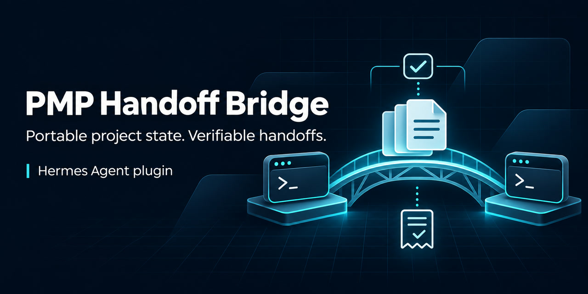
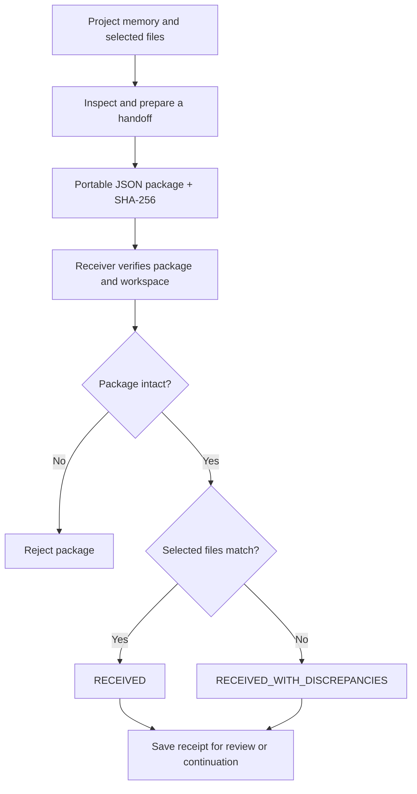
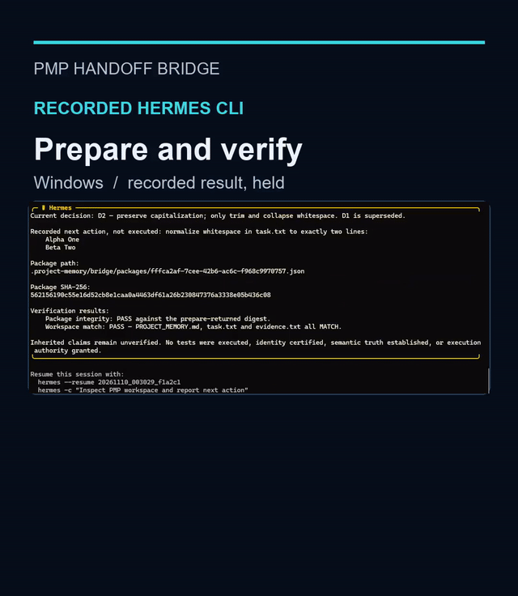

# PMP Handoff Bridge



**Give the next AI agent the context to continue a project — and the ability to check whether that context still matches the files.**

[Hermes Marketplace](https://hermes-agent.nousresearch.com/marketplace/pmp-handoff-bridge) · [Watch the 83-second demo](https://x.com/MaxDevsLabs/status/2120122902318125209) · [Project Memory Protocol](https://github.com/Mad-Max8063/project-memory-protocol-public)

[](https://hermes-agent.nousresearch.com/marketplace/pmp-handoff-bridge)
[](LICENSE)

PMP Handoff Bridge is an experimental, open-source plugin for Hermes Agent, built around [Project Memory Protocol (PMP)](https://github.com/Mad-Max8063/project-memory-protocol-public). PMP records a project's current state, decisions, evidence, constraints and next action in a portable `PROJECT_MEMORY.md` file. The bridge packages that state with explicitly selected files, detects changes to those files, and saves a receipt when the handoff is received.

## Why this exists

Imagine an AI agent finishing a task and handing the project to another agent. A good handoff explains what happened and what to do next. But what if a file changes after that handoff is prepared? The receiving agent may have a perfectly intact package that no longer reflects the workspace.

The bridge lets the receiving agent check both things separately: **is the package intact, and do the selected local files still match it?** It creates a persistent record of what was checked without replacing canonical project memory or automatically executing the next action.

## How it works



The human operator controls which files are packaged and how the package is transferred. The four native Hermes tools implement the checks and persist the results locally. There is no bridge-operated model, server, database, network client or background task.

### A concrete example

The included demonstration uses a small, fictional task with three selected files: `PROJECT_MEMORY.md`, `task.txt` and `evidence.txt`.

| Stage | Package integrity | Workspace match | Result |
| --- | --- | --- | --- |
| Prepare and verify | PASS | PASS | Selected files match the handoff |
| Operator changes `task.txt` | PASS | FAIL | `RECEIVED_WITH_DISCREPANCIES` |
| Operator restores the original bytes | PASS | PASS | `RECEIVED` |

Both receipts record what was observed. The original project memory is preserved. The recorded demo exercises these operations through the native Hermes CLI using a resumed session, and the repository includes a model-free replay of the same workflow.

### See it in action

[](https://x.com/MaxDevsLabs/status/2120122902318125209)

*15-second excerpt of the recorded Windows CLI demonstration, accelerated and cropped for readability. [Watch the complete 83-second demo with narration and English captions](https://x.com/MaxDevsLabs/status/2120122902318125209).*

## Install in Hermes

Version 0.1.0 is listed in the **community / Tools** category of the [Hermes Marketplace](https://hermes-agent.nousresearch.com/marketplace/pmp-handoff-bridge), added on November 11, 2026 via [the merged catalog PR #153689](https://github.com/NousResearch/hermes-agent/pull/153689). It requires Hermes 0.21.6 or newer and lists Windows and Linux.

```text
hermes plugins install pmp-handoff-bridge
hermes plugins enable pmp-handoff-bridge
```

Set `PMP_BRIDGE_WORKSPACE` to the absolute path of the project you authorize **before** starting the Hermes session that will use the tools, for example a disposable workspace created by the offline demo below. No plugin-specific API key is needed. Model usage is managed by Hermes through your own configured provider.

The catalog pins the reviewed source at [`04f0471`](https://github.com/Mad-Max8063/pmp-handoff-bridge/tree/04f04711dfc10edbf9e77bb98dd390ab03bea60c). Catalog installation uses that exact revision; documentation on this repository's default branch may evolve separately.

## Requirements and local quick start

- Python 3.12+ (host verification uses the version recorded in evidence).
- Hermes is optional for offline operation; native compatibility is a separate gate.
- No Python packages need to be installed for the bridge or offline tests.

Clone the repository and run the checks from its root directory:

```text
git clone https://github.com/Mad-Max8063/pmp-handoff-bridge.git
cd pmp-handoff-bridge
python -B -m unittest discover -s tests -v
python -B scripts/demo.py
```

Use `python3` in place of `python` if that is your Python command on Linux or WSL2.

The demo creates a new synthetic workspace under `.runtime/`, prepares a package,
verifies it, modifies one selected file, records the discrepancy, restores that
synthetic file, and receives the valid package. It preserves canonical memory.
It prints the run directory and receipt path. No agent/model is invoked.

Expected output includes `status: PASS`, six completed tool operations and a receipt path. Open the printed run directory's `demo-report.json` to inspect the actual results and observed hashes. You can reproduce this check without a Hermes account or model subscription.

## Tools

All tools require `workspace_path`, an absolute local directory identical to the
operator's process-level `PMP_BRIDGE_WORKSPACE`. Missing authorization fails closed.
Changing that variable is an operator action; a package cannot select its root.

| Native tool | Additional arguments | Effect |
| --- | --- | --- |
| `pmp_inspect` | none | Read canonical PMP, version, sections, structural errors |
| `pmp_prepare_handoff` | `files`, `objective`, `producer`, `project` | Append a self-contained JSON package |
| `pmp_verify_handoff` | `package_path`, optional `expected_sha256` | Check embedded bytes and compare local files |
| `pmp_receive_handoff` | same plus `receiver` | Append a receipt after package verification |

`files` is an explicit list, including `PROJECT_MEMORY.md`. Paths use `/`.
`producer`, `project` and `receiver` are declared metadata, not identity proofs.
`package_path` is relative to the authorized workspace. To transfer a package,
copy only that JSON file into the receiver's workspace, for example into
`.project-memory/bridge/inbox/`. Copying is an explicit operator step; the bridge
does not fetch URLs or extract files over local state.

Supply the SHA-256 returned by preparation through a separately trusted channel
as `expected_sha256` when available. Internal checksums detect inconsistency;
someone who can rewrite the whole package can also recompute them. An external
digest is only as trustworthy as the channel that delivered it.

### Offline CLI (same implementation as the native tools)

Select a disposable workspace created by the demo:

```powershell
$env:PMP_BRIDGE_WORKSPACE = 'C:\absolute\path\to\the\demo-workspace'
@{ workspace_path = $env:PMP_BRIDGE_WORKSPACE } |
    ConvertTo-Json -Compress |
    python -B -m bridge pmp_inspect

@{
    workspace_path = $env:PMP_BRIDGE_WORKSPACE
    files = @('PROJECT_MEMORY.md', 'task.txt', 'evidence.txt')
    objective = 'Review the bounded label task before continuing.'
    producer = 'operator-declared-producer'
    project = 'synthetic-label-task'
} | ConvertTo-Json -Compress | python -B -m bridge pmp_prepare_handoff
```

Use the returned `package_path` and `package_sha256` in a JSON argument object
for `pmp_verify_handoff`, then add `receiver` for `pmp_receive_handoff`.
The CLI reads bounded JSON from stdin; it never evaluates a command from JSON.
Exit codes: `0` successful/matching, `1` invalid inspected PMP or workspace drift,
`2` rejected input/filesystem/package. A drift receipt is still persisted with exit 1.

## Native Hermes setup and validation

Set `PMP_BRIDGE_WORKSPACE` to the absolute disposable fixture workspace you authorize. This variable is a local path, not a credential. Prepare a fresh isolated home:

```text
python -B scripts/install_local.py --home /absolute/path/to/new-hermes-home
```

The installer refuses an existing home. In that terminal set `HERMES_HOME` to the new home, set `PMP_BRIDGE_WORKSPACE`, then use your installed Hermes version's help before running:

```text
hermes plugins doctor /absolute/path/to/plugin --ci
hermes plugins validate /absolute/path/to/plugin --install-deps
```

The plugin has no Python dependencies. Hermes installation/authentication and the selected model are operator-managed. Agent inference can use the operator's existing model access; offline verification makes no model calls. Do not copy authentication files into a project or repository.

Documented native execution used Windows Hermes 0.21.6+607.gc573316 with a project-local clean OpenAI SDK, and Ubuntu/WSL2 Hermes 0.23.0 on a second notebook. The Windows SDK workaround is specific to that host; this repository does not patch or redistribute Hermes. See evidence/RESULTS.md. Compatibility on untested versions is not claimed.

## Package and receipt contract

`pmp-handoff-bridge/1` contains a SHA-256 of canonical JSON payload bytes; the
payload contains ID, UTC creation time, declared producer/project, objective,
PMP 0.2.2 snapshot, and files with relative paths, sizes, SHA-256 and base64 bytes.
The snapshot must match the embedded canonical memory. Unknown fields, duplicate
JSON keys, incompatible versions and ambiguous/colliding paths are rejected.
This transport is experimental and does not change PMP Core.

Package checks and workspace checks are independent:

- Invalid package: reject; do not create a successful reception receipt.
- Intact package, unchanged selected files: `RECEIVED`.
- Intact package, missing/modified/unsafe local files: `RECEIVED_WITH_DISCREPANCIES`.

Every receipt includes observed hashes, discrepancies, inherited next action,
pending review, timestamp and explicit false values for tests executed, identity
verified, truth verified and authority granted. It does not overwrite decisions,
constraints or canonical memory. Receipt data is also local, unsigned evidence.
PMP Evidence references remain inherited text; only selected bytes are checked.

## Boundaries

- 32 selected files; 256 KiB/file; 2 MiB total decoded bytes; 4 MiB JSON package.
- No recursive collection or command execution; no conversations collected.
- Reject absolute/UNC/drive paths, traversal, ADS, reserved Windows names,
  symlinks, junctions/reparse points and hardlinked files, including linked ancestors.
- Credential/runtime paths are denied; known secret patterns are rejected.
  This is not comprehensive secret detection: review the explicit selection.
- Exact byte hashes intentionally flag CRLF/LF changes; no hidden normalization.
- Exclusive writes preserve existing artifacts. An interrupted write can leave
  an invalid new artifact; this is not a multi-file crash-proof transaction.
- File checks mitigate accidental replacement but do not defend against an
  adversarial concurrent process racing filesystem operations. No OS sandbox claim.
- Structural validation is not semantic understanding, truth checking, general
  contradiction detection, complete PMP conformance, model identity, or freshness.
- The fixture's inherited report is explicitly synthetic. Actual tool evidence
  is produced by the check/demo runners, not asserted by the fixture.

## Evidence and review status

| Check | Observed result |
| --- | --- |
| Offline core tests | 18 tests passed from a fresh public checkout |
| Native Windows CLI | All four tools exercised; both receipt hashes independently checked and original fixture bytes restored |
| Ubuntu/WSL2 | 18 tests and native plugin registration/validation passed; operator-reported live tool use with archived receipts |
| Hermes local admission command | `hermes plugins validate --install-deps --json` passed at the catalog-pinned commit; two scanner cautions on the unchanged vendored Markdown parser were disclosed |
| Hermes catalog | Community entry merged through [PR #153689](https://github.com/NousResearch/hermes-agent/pull/153689) |

[Watch the actual CLI recording in the demo](https://x.com/MaxDevsLabs/status/2120122902318125209) or inspect the [sanitized Windows results](evidence/windows-cli.json). [Results and limits](evidence/RESULTS.md) and [candidate validation](evidence/candidate-validation.json) preserve earlier development observations, including the initial dependency-preparation blocker that was resolved before catalog submission. [Provenance](PROVENANCE.md) identifies the two unchanged MIT source modules and their origin hashes. See the [original catalog submission](https://github.com/NousResearch/hermes-agent/pull/152592) for disclosures and the full local validation summary.

This is a bounded synthetic experiment. The program checks selected bytes and records reception; it does not certify model identity, claim truth, semantic consistency or session freshness. Marketplace inclusion is a review of the pinned revision, and is not an independent security audit or proof of general reliability.

Delete only a reviewed disposable `.runtime/<run>` directory to clean local runs.
Keep any evidence you need first. The plugin creates no cloud resources to clean.

## Disclosures

The plugin reads explicitly selected files inside the operator-authorized workspace, which is outside its own installation directory, and writes append-only packages/receipts under that workspace. It stores selected file bytes in packages: choose files that are safe to share. It does not read credential stores, send telemetry, contact network services, execute shell commands, self-update, patch Hermes, or start background tasks. Host plugin execution is not an OS sandbox. Receipts are unsigned local observations. Hashes do not certify agent identity, semantic truth, session freshness, or authorization.

The reviewed MIT parser and validator provenance is in PROVENANCE.md. Local developer runtime diagnostics and model runners are excluded from this repository. PMP Core remains optional and unchanged.

## Contribute

Feedback, reproducible test reports and suggestions for improved cross-agent handoffs are welcome via [GitHub issues](https://github.com/Mad-Max8063/pmp-handoff-bridge/issues). Start with the offline replay, and describe the environment and observed result if you try the plugin in Hermes.

[MIT license](LICENSE) · Made by [Max Devs Labs](https://github.com/Mad-Max8063).
